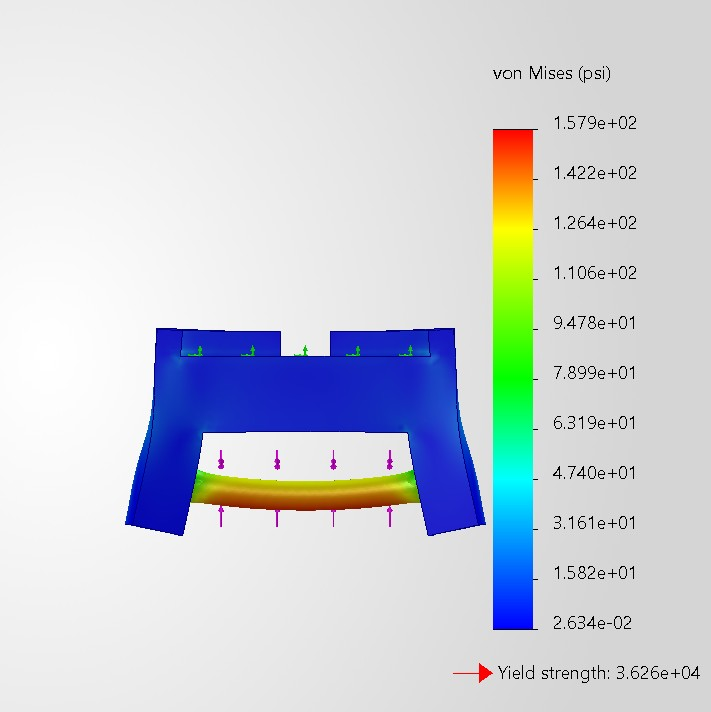
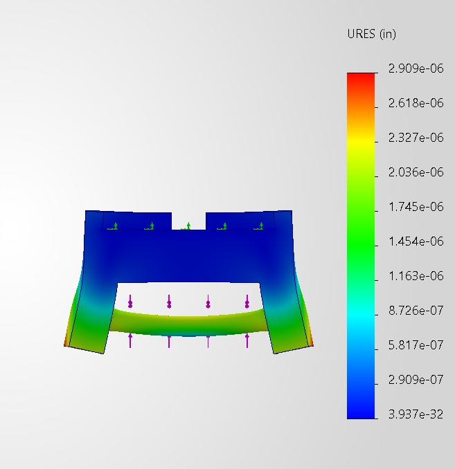
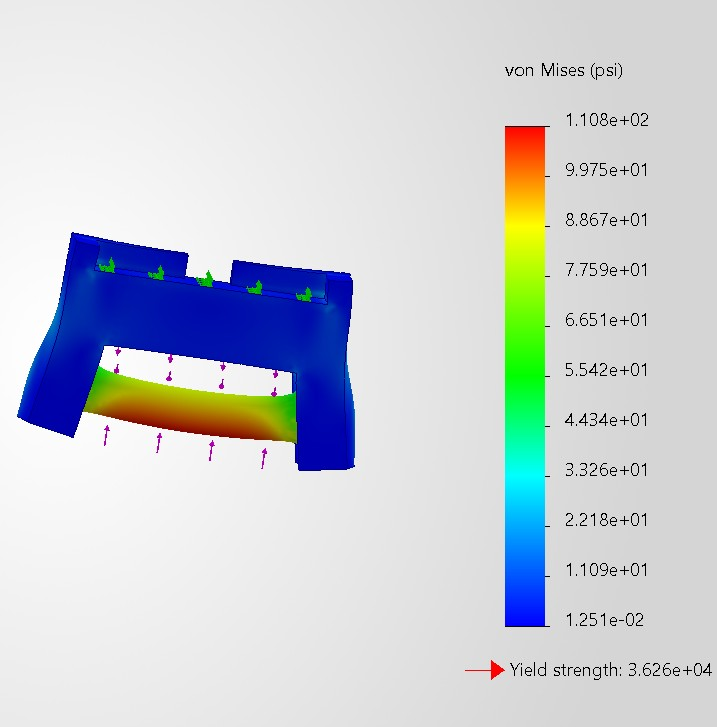
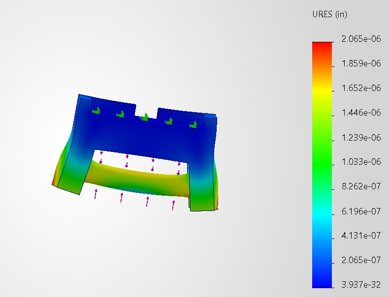
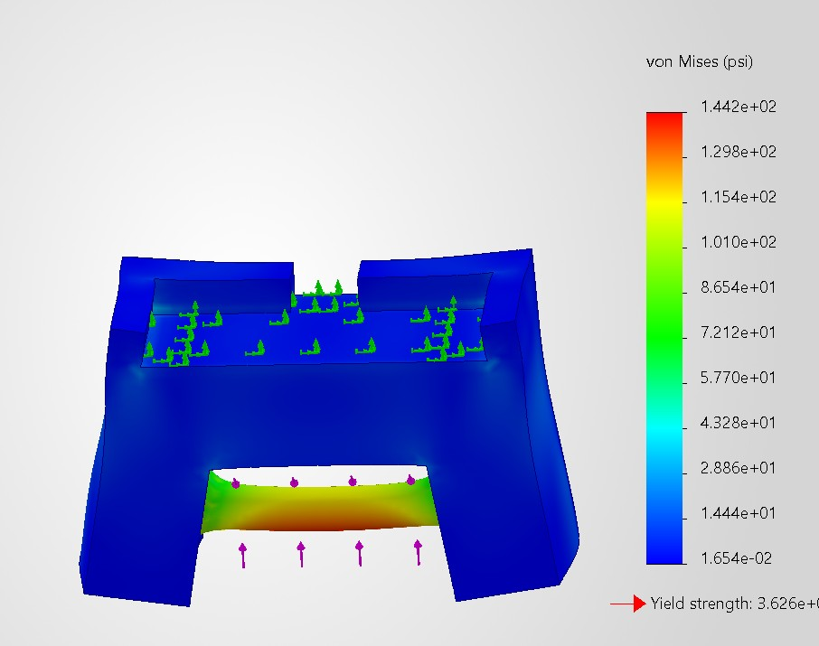
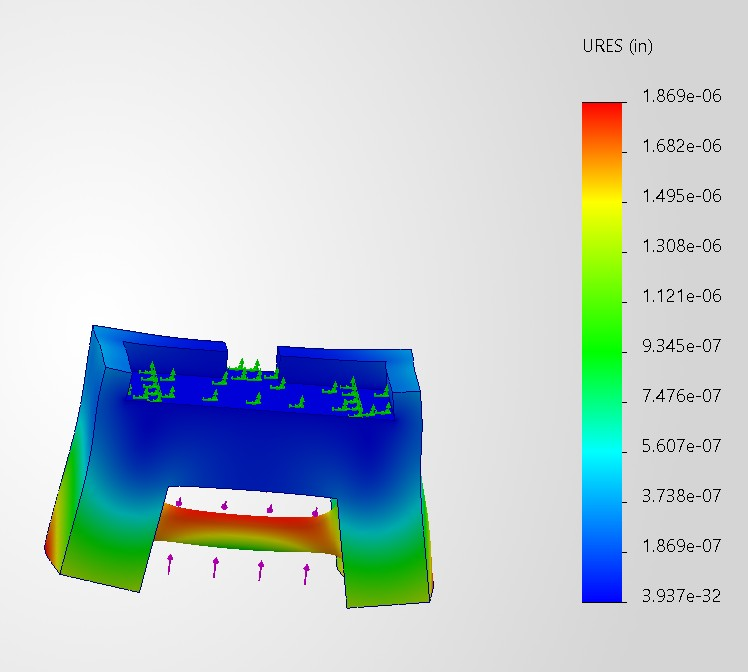

# A7 – [FEA of bracket]

All of the designs are made from the same material and it is A36 Steel.
Each element analysis number were taken from the finest mesh count that solid works could do.
The masses of each object increase as the designs contue

## Design 1

safety factor of 229

## Design 2
made the cylinder diameter go from .5 to .75in-saftey 
factor of 327

## Design 3
changed the wall thickness on the bottom from .5in to .75 in 
safety factor of 251

## reflection
I would use the second design if I has to pick on for cost and how safe it is.

Through this assinment I learned how different meshes work and how to do fea work in solidworks to help improve 3d designes.

[CAD-model]([https://example.com](https://github.com/Gavin-Anderson-ME/-megr2157-portfolio/blob/main/docs/assignments/A07/bracket.SLDPRT)
https://github.com/Gavin-Anderson-ME/-megr2157-portfolio/blob/main/docs/assignments/A07/bracket.SLDPRT

