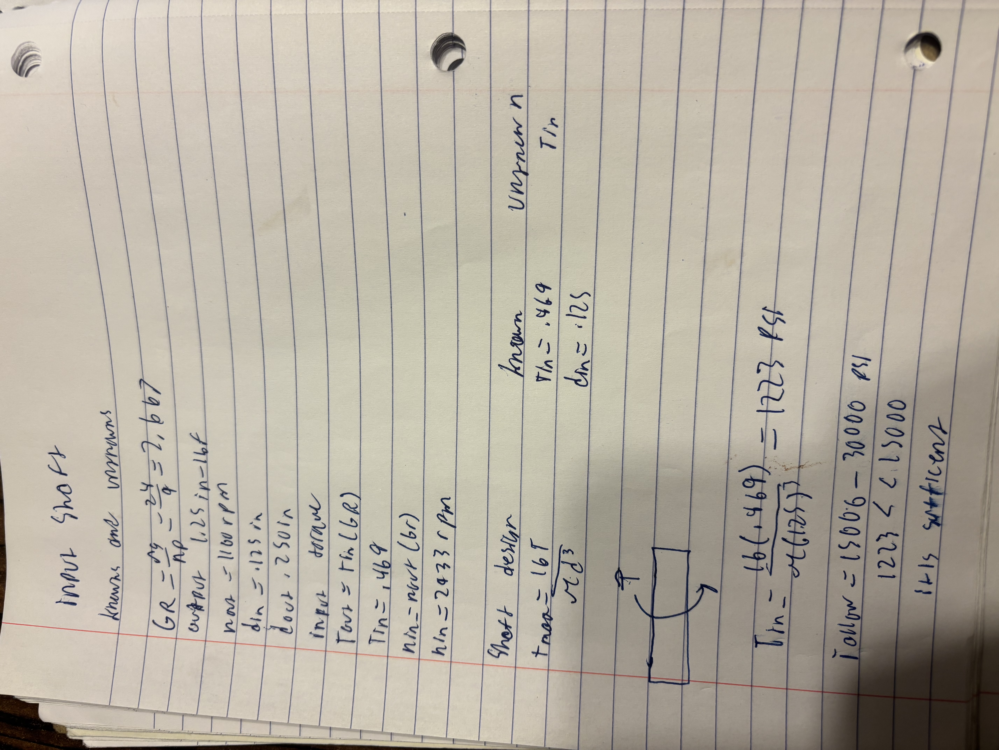
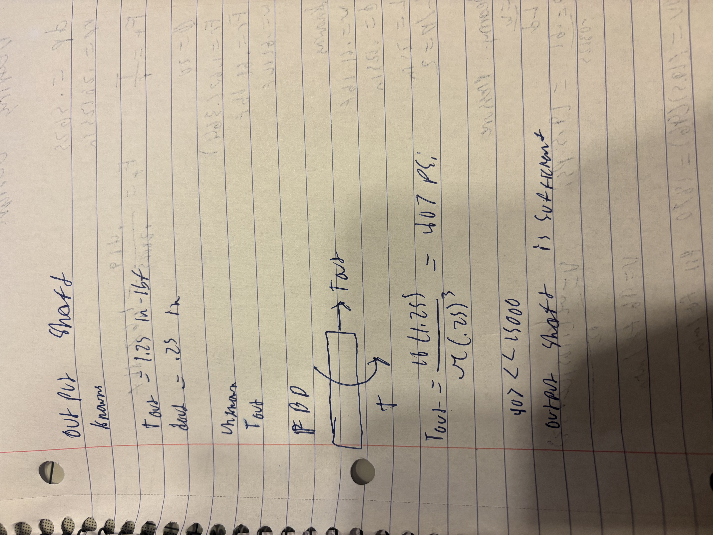
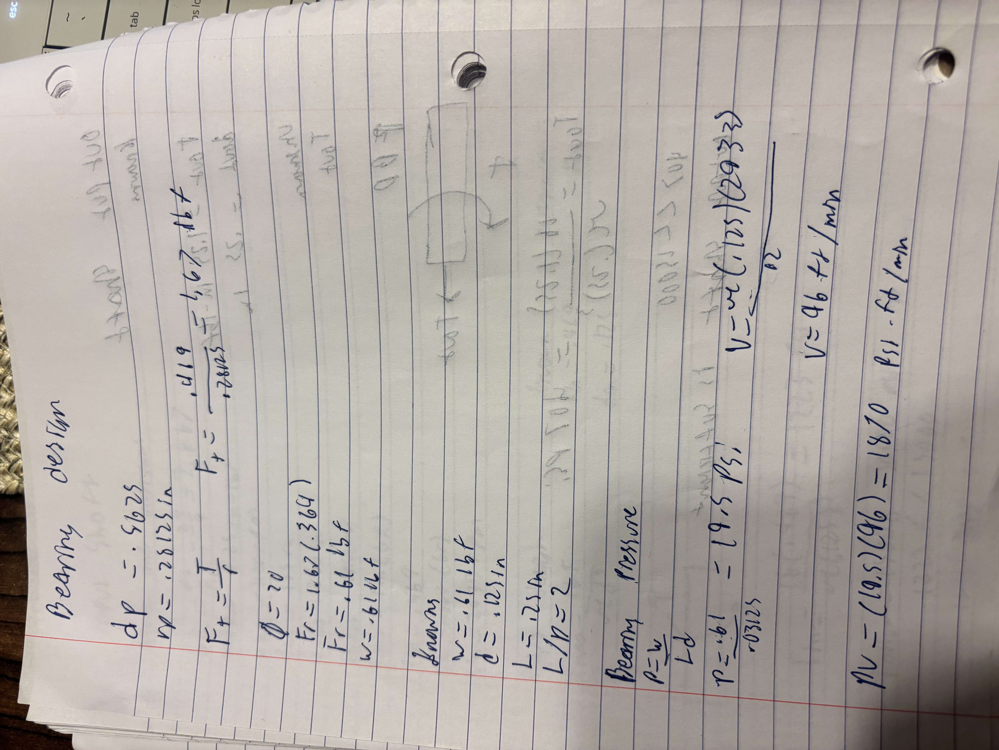
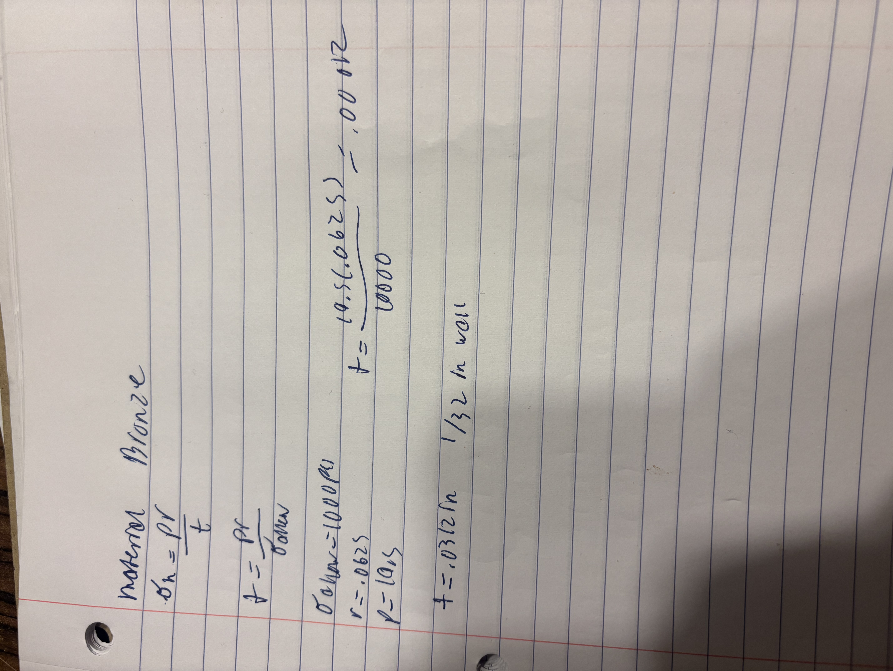
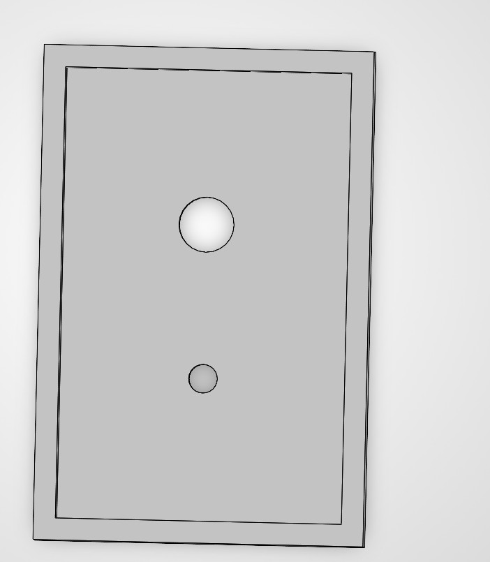
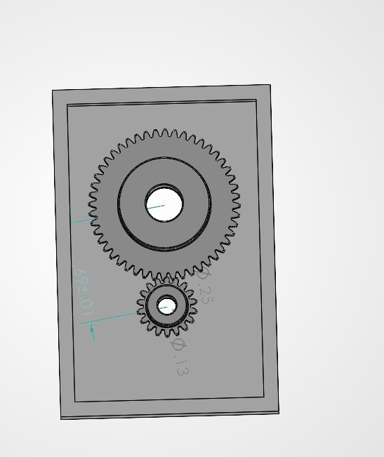

# A8 – Gears

## Input shaft

Here is an image of all of the work done and calculations for the input shaft

## output shaft

Here is an image of the work done and calculations for the put out shaft

## journal bearing

These are images of the work and calculations done for the journal bearings.

The material chosen for the journal bearings is oiled embedded bronze bearing.

## CAD

Here is an image of the gear box shell cut in half.

Here is an image of what the gear box will look like with the gears actually in it.

The gear box should also be made out of 6061-T6 aluminum

during this assignment I learned how to adjust a bearings size based off how the velocity and PV reading that would be acting on it and how to do those calculations.

CAD files  

https://github.com/Gavin-Anderson-ME/-megr2157-portfolio/blob/main/docs/assignments/A08/gearbox.SLDASM

