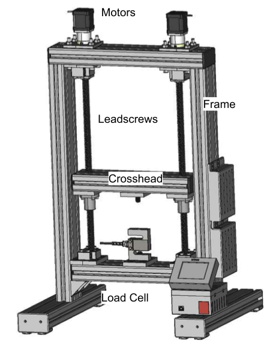
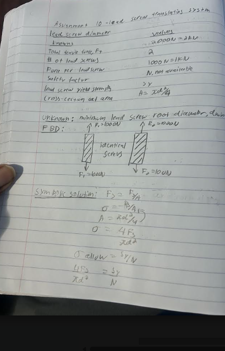
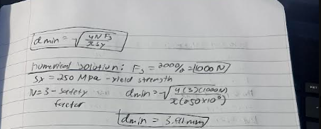
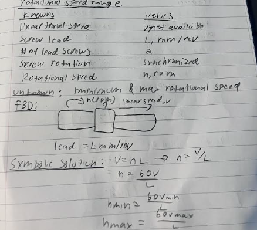
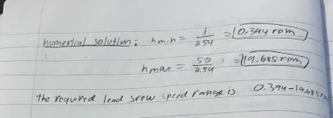
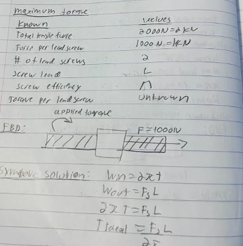
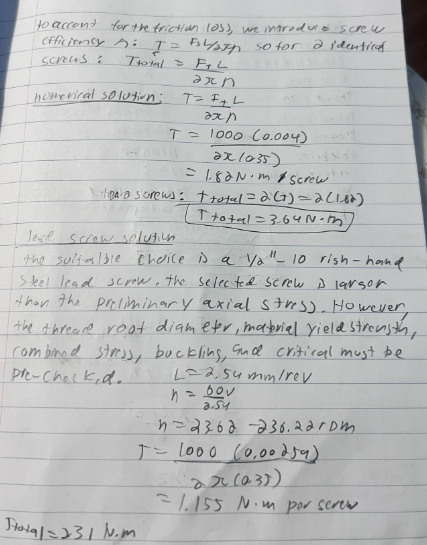
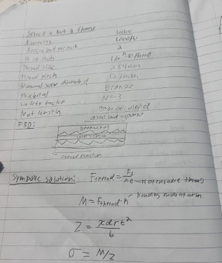
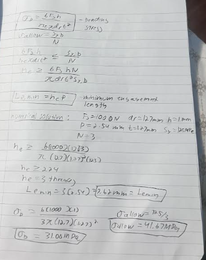

# A10 – Lead Screw Translating System

## leadscrew diameter (Kiishi Ayoola)

After writing down my knowns and unknown variables, I began to calculate the minimum diameter of the lead screw. First, I identified the maximum tensile load that the machine must support, which is 2000 N. since the tensile tester uses two identical screws, I assumed that the load would be distributed equally. We divided the total force by two, by giving each load 1000 N in the Free body diagram. We then identified the required safety factor of 4 and assumed the yield strength of 250 MPa for our calculations.

Next, I used the axial stress equation F/A to determine the minimum cross sectional area needed to support the applied load. due to the circular cross section in the screw, I substituted the area equation A = pid^2/4 into the axial equation. also, I divided the yield strength by the safety factor to find out the allowable stress. After rearranging the equations to solve for diameter, I substituted the known values to get it.

After finding the minimum diameter, I compared it to the commercially available screws. I chose a 1/2"-10 steel lead screw with a nominal diameter of 12.7mm. This was selected as a preliminary option because its nominal diameter is larger than the calculated minimum.

Using the diameter, I calculated the rotational speed required to achieve the specified crosshead movement of 1 to 50 mm/min. I used the chosen screw, which has 10 threads per inch. I then divided 25.4 mm by 10 to obtain a lead of 2.54 mm per revolution. I then used the relationship between linear speed, rotation speed, and screw lead. After rearranging the equation v = nL, I solved for rational speed. I calculated for the minimum linear speed and maximum linear speed with that calculation.

The next step was determining how much torque would be required to roate the lead screw while applying the maximum tensile load. we used the 1000 N load acting on each screw and an assumed mechanical effieceny of 35 percent. the efficiency accounts for energy lost through friction as the screw rotates inside the nut. I used the torque equation T = FL/(2pi*n) and substituted the known values to find the required torque for one lead screw. Since there are two identical lead screws, I multiplied the result by two to estimate the total torque required .

## Nut and Flange (Kiishi Ayoola)

To find the nut and flange of the tensile tester, I considered the axial load transferred from each lead screw to the crosshead. Since the total applied load is 2000 N and the machine uses two lead screws, each bronze nut must support 1000 N. I chose bronze as the preliminary nut material because it is commonly used with the steel lead screws due to its wear resistance and sliding properties. Next is I found the internal threads of the bronze nut could withstand the applied force without failing in bending. I used a yield strength of 125 MPa and the required safety factor of 4. I divided it by the safety factor. I then identified the thread dimensions needed for the bending stress calculation. Based on the thread geometry, I used a pitch of 2.54 mm, a thickness of 1.27mm, a thread height of 1 mm, and an effective root diameter of 10.2 mm. Afterwards, I simplified the thread bending stress equation to determine the minimum number of engaged threads needed to support the axial load. I rearranged this equation to solve for the number of engaged threads and substituted the known values, including the safety factor. Since the number of threads must be a whole number, I rounded to the next whole number. with the threads, I calculated the minimum engagement length by multiplying the number of threads by the thread pitch

## Design the Crosshead ( Gavin Anderson)

In these photos you will find all of the calculations, FBDs and the drawings for the Crosshead. The final height was set to 20mm and it was 300mm long and the width was set to 80mm.

## Tabulating Costs (Kiishi Ayoola)

## Parametric Modeling (Gavin Anderson)

## lesson learned (Gavin Anderson)

